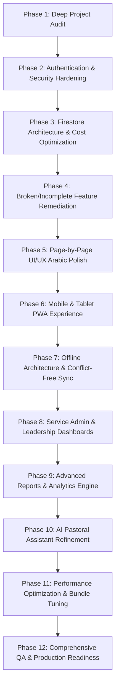

# MASTER PLAN — KHIDMETY PRO (خدمتي برو)

## Executive Summary
This document establishes the comprehensive engineering architecture, milestone roadmap, and execution strategy for transforming **KHIDMETY PRO** into an enterprise-grade, highly secure, offline-resilient, and production-ready church service management platform.

---

## Non-Negotiable Architecture Constraints
1. **Single Database Standard:** Firebase Cloud Firestore is the **ONLY** database for the application. No alternative or parallel databases (MySQL, Postgres, MongoDB, SQLite, Supabase) are permitted for web platform data.
2. **Identity & Auth:** Firebase Authentication handles user identity with custom claims (`role`, `code`, `perm`).
3. **Data Preservation:** Zero data loss. All historical student profiles, attendance logs, exam grades, and spiritual notes must remain intact.
4. **Offline First:** Cloud Firestore offline persistence is enabled across tabs (`synchronizeTabs: true`) with explicit sync status indicators.
5. **Language & UX:** 100% Arabic user interface with comprehensive RTL styling, accessible typography, and dual Coptic/Gregorian liturgical calendar integration.

---

## Development Roadmap (Phases 1 to 12)

### Phase 1: Complete Project Audit
- Detailed inventory of all 27 HTML pages, client scripts (`js/`), serverless APIs (`api/`), and automated test suites.
- Static analysis for security vulnerabilities, exposed credentials, unhandled promises, and inline script discrepancies.
- Evaluation of current Firestore security rules vs client query patterns.

### Phase 2: Authentication & Security Improvements
- Audit and strengthen `api/_lib/auth.js` and `api/login.js`.
- Ensure uniform verification across all API endpoints: `api/admin.js`, `api/harvest.js`, `api/submit_sheet.js`, `api/spiritual_note.js`, `api/mark_plan_read.js`.
- Audit Firestore rules (`firestore.rules`) against rule traversal vulnerabilities and student data isolation.
- Enforce brute-force attack protection and lockout mechanisms in `index.html` and `auth-client.js`.

### Phase 3: Firestore Architecture, Queries, Indexes & Cost Optimization
- Harmonize legacy collection names (`students` vs `members`, `attendance` date keys).
- Optimize client query batch sizes and prevent unbounded collection listeners (`onSnapshot` leak prevention).
- Update and audit `firestore.indexes.json` for all compound queries.
- Structure document schemas for minimal read/write footprint to fit comfortably within the Firebase Spark free tier.

### Phase 4: Repair Broken or Incomplete Features
- Audit all modal triggers, action buttons, and forms across all 27 pages.
- Fix any broken links, missing fallbacks in `data-smart-back`, and uncaught errors in console.
- Ensure all legacy Google Apps Script references are completely superseded by Firestore.

### Phase 5: Improve All Pages and User Interfaces
- Standardize Arabic RTL styling, typography, spacing, and accessibility across all pages.
- Modernize cards, tables, buttons, and badges with gold-navy ecclesiastical theme (`#0c2461`, `#1e3799`, `#d4af37`, `#059669`).
- Ensure every form features Arabic real-time validation and accessible error toasts.

### Phase 6: Mobile & Tablet PWA Experience
- Validate `manifest.json`, service worker (`sw.js`), and offline asset caching.
- Guarantee touch targets >= 48px, smooth mobile scrolling, and viewport meta responsiveness.
- Verify safe bottom navigation and floating action buttons on mobile screens.

### Phase 7: Offline Architecture & Synchronization
- Confirm `db.enablePersistence({ synchronizeTabs: true })` across all client modules.
- Add visible online/offline network indicator banner with auto-reconnect toasts.
- Ensure idempotent write operations to prevent duplicate attendance or grade submissions when reconnecting.

### Phase 8: Service Administration & Operational Dashboards
- Polish `servant-dashboard.html` tabs: Executive Radar, Fasting/Liturgical Calendar, Servant Attendance, Master Plan, Curriculum Schedule.
- Polish `servant_grades_entry.html` with real-time reality curve, bonus point adjustments, and student export.

### Phase 9: Reports, Statistics & Analytics Engine
- Enhance weekly automated Excel export (`XLSX`) with full metadata, formula cells, and styling.
- Provide attendance trend charts, absence radar filters (3+ weeks critical dropouts), and confession deadline countdowns.

### Phase 10: AI Pastoral Assistant Evaluation & Implementation
- Refine the Coptic liturgical knowledge base, Bible quiz engine (`quiz.html`), and spiritual notes advisor.
- Verify safety guardrails to ensure orthodox pastoral responses.

### Phase 11: Performance Optimization
- Eliminate redundant DOM queries and optimize repaints.
- Implement lazy loading for media and large datasets.
- Ensure clean memory teardown on tab switches and modals.

### Phase 12: Comprehensive Quality Assurance & Production Release
- Expand test suites to cover all new features and security endpoints.
- Run all test suites to achieve 100% PASS rate.
- Generate final Arabic verification report for the project owner.
