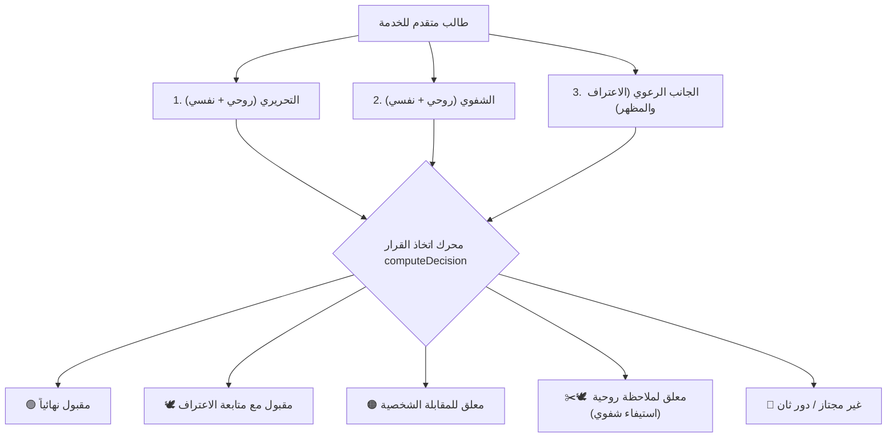

# 📖 الدليل الشامل والمرجع التشغيلي لمنظومة رصد درجات إعداد الخدام
### St. Paul Service System — Khedmety Plus | `servant_grades_entry.html`

---

## 📑 فهرس المحتويات
1. [المقدمة وفلسفة المنظومة ثلاثية الأركان](#1-المقدمة-وفلسفة-المنظومة-ثلاثية-الأركان)
2. [الخريطة الهيكلية للواجهة (UI Blueprint)](#2-الخريطة-الهيكلية-للواجهة-ui-blueprint)
3. [شريط التنقل العلوي والإجراءات السريعة (Topbar)](#3-شريط-التنقل-العلوي-والإجراءات-السريعة-topbar)
4. [لوحة النبض التنفيذي وشريط الطيف البصري (Pulse & Spectrum)](#4-لوحة-النبض-التنفيذي-وشريط-الطيف-البصري-pulse--spectrum)
5. [استوديو التحكم الذكي في الواقع والشرائح (Unified Reality Studio)](#5-استوديو-التحكم-الذكي-في-الواقع-والشرائح-unified-reality-studio)
   - [شريط التبديل السريع القابل للطي](#شريط-التبديل-السريع-القابل-للطي)
   - [التبويب 1: مستكشف ومحاكي الواقع (Reality Explorer)](#التبويب-1-مستكشف-ومحاكي-الواقع-reality-explorer)
   - [التبويب 2: جدول توزيع النسب والـ 11 شريحة (Distribution Deciles)](#التبويب-2-جدول-توزيع-النسب-والـ-11-شريحة-distribution-deciles)
   - [التبويب 3: معايير وخلاط المواد الأربعة (Exam Mixer)](#التبويب-3-معايير-وخلاط-المواد-الأربعة-exam-mixer)
   - [التبويب 4: حدود القبول والدرجات العظمى (Rules & Scale Config)](#التبويب-4-حدود-القبول-والدرجات-العظمى-rules--scale-config)
   - [التبويب 5: سجل ومتابعة أصحاب الملاحظات والمعلقين (Notes & Holdouts Tracker)](#التبويب-5-سجل-ومتابعة-أصحاب-الملاحظات-والمعلقين-notes--holdouts-tracker)
6. [منظومة الفلترة متعددة الأبعاد وشريط التبويبات السريعة](#6-منظومة-الفلترة-متعددة-الأبعاد-وشريط-التبويبات-السريعة)
7. [جدول الرصد والتقييم الرئيسي (Main Grades Table)](#7-جدول-الرصد-والتقييم-الرئيسي-main-grades-table)
8. [الأنظمة والأوضاع الخاصة المتقدمة](#8-الأنظمة-والأوضاع-الخاصة-المتقدمة)
   - [وضع الرصد فائق السرعة بالكيبورد والباركود (Fast Entry Mode ⚡)](#وضع-الرصد-فائق-السرعة-بالكيبورد-والباركود-fast-entry-mode-)
   - [بطاقة المخدوم الرعوية الشاملة (Candidate 360° Drawer 🪪)](#بطاقة-المخدوم-الرعوية-الشاملة-candidate-360-drawer-)
   - [مساعد الضبط الذكي للقبول (Sweet Spot Optimizer 🪄)](#مساعد-الضبط-الذكي-للقبول-sweet-spot-optimizer-)
   - [منظومة رسائل الواتساب الرعوية الذكية (WhatsApp Campaigns)](#منظومة-رسائل-الواتساب-الرعوية-الذكية-whatsapp-campaigns)
   - [منظومة تصدير الإكسيل بالمعادلات الحية (Live Excel Export)](#منظومة-تصدير-الإكسيل-بالمعادلات-الحية-live-excel-export)
   - [الترقيم السلس وإدارة حجم الصفحة (Pagination)](#الترقيم-السلس-وإدارة-حجم-الصفحة-pagination)
9. [دليل القرارات والمعادلات الحسابية والمنطق البرمجي](#9-دليل-القرارات-والمعادلات-الحسابية-والمنطق-البرمجي)
10. [الأسئلة الشائعة ودليل الطوارئ (Troubleshooting & FAQ)](#10-الأسئلة-الشائعة-ودليل-الطوارئ-troubleshooting--faq)

---

## 1. المقدمة وفلسفة المنظومة ثلاثية الأركان

تم تصميم وتطوير صفحة [`servant_grades_entry.html`](file:///D:/StPaul_Service_System/03_Web_Khedmty_Plus/public/servant_grades_entry.html) لتكون **غرفة القيادة والتحكم الشاملة** لامتحانات قبول وتأهيل الخدام والخادمات باجتماع القديس بولس الرسول.

تقوم المنظومة على **الفلسفة ثلاثية الأركان الرعوية**:
1. **الركن الأكاديمي والكنسي:** اختبارات كتابية ومقابلات شفاهية في العقيدة والطقس والكتاب المقدس والألحان.
2. **الركن النفسي والسلوكي:** قياس سمات النضج الانفعالي والاتزان السلوكي والقدرة على العمل الجماعي والافتقاد.
3. **الركن الرعوي والروحي:** التأكد من الانتظام في سر الاعتراف والتناول، ومظهر الخادم ووقاره، وحل أي معوقات بروح المحبة والاحتواء دون تعسف.



---

## 2. الخريطة الهيكلية للواجهة (UI Blueprint)

تتوزع شاشة رصد الدرجات إلى مناطق عمل متناسقة لتفادي التشتت:

| المنطقة | العنصر البرمجي (DOM ID / Class) | الوظيفة الأساسية |
| :--- | :--- | :--- |
| **1. شريط التنقل** | `.topbar` | العودة، الاستيراد، التصدير، واعتماد الحفظ المحلي |
| **2. نبض الدفعة** | `.kpi-grid` & `.spectrum-bar` | 5 عدادات تنفيذية وشريط طيف لنسب القرارات الأربعة |
| **3. الاستوديو الذكي** | `#studioToggleBar` & `#unifiedStudioPanel` | 5 تبويبات تفصيلية لتحليل المنحنيات وجداول النسب |
| **4. معايير الشرائح** | `.criteria-grid-4` (5 بطاقات) | كروت إحصائية تفاعلية قابلة للنقر لفلترة الحالات |
| **5. شريط التبويبات** | `#statusQuickTabsBar` | 7 تبويبات سريعة للتنقل بين فئات الطلاب بنقرة واحدة |
| **6. أدوات الفلترة** | `.filters-toolbar-box` | البحث الفوري، وضع الرصد السريع، التقارير، ودرج الفلاتر الـ 8 |
| **7. جدول الرصد** | `#gradesTable` | جدول الـ 12 عموداً للرصد والتعديل والملاحظات والترقيم |
| **8. الدرج الجانبي** | `#candidate360Drawer` | ملف المخدوم الشامل (360°) والواتساب الفوري |
| **9. وضع الرصد السريع**| `#fastEntryOverlay` | شاشة رصد عريضة مركزة مخصصة للكيبورد والباركود |

---

## 3. شريط التنقل العلوي والإجراءات السريعة (Topbar)

يقع في أعلى الشاشة ويحتوي على الأزرار السيادية:
- **`العودة للوحة الخدمة` (`data-smart-back`):** زر ذكي يعود للشاشة السابقة أو يتجه افتراضياً لتبويب الكورسات في لوحة الخادم.
- **`استيراد البيانات` (`openImportModal()`):** نافذة تتيح سحب كشوف Excel أو جداول Google Forms برمجياً ورصد أسماء وأكواد وهواتف المخدومين في ثوانٍ.
- **`كشف رسائل الواتساب` (`openWhatsappCampaignModal()`):** إطلاق حملات الإشعارات الموجهة لكافة المقبولين والمعلقين.
- **`تصدير PDF رسمي` (`openPdfExportModal()`):** طباعة كشف معتمد بالأسماء والدرجات لتقديمه للأب الكاهن وأمين الخدمة.
- **`تصدير إكسيل معتمد` (`exportDetailedCriteriaExcel()`):** ملف إكسيل متكامل يحتوي على معادلات حية وملخص شامل وملاحظات.
- **`اعتماد ورصد الدرجات` (`saveGradesLocal(true)`):** حفظ فوري لكافة التعديلات في ذاكرة الجهاز (LocalStorage) مع تنبيه بصري أخضر.

---

## 4. لوحة النبض التنفيذي وشريط الطيف البصري (Pulse & Spectrum)

### عدادات الـ KPIs الخمسة:
1. **إجمالي المسجلين (`#kpiTotal`):** العدد الإجمالي للشباب المقيدين في الكشف.
2. **متوسط الدفعة العام (`#kpiAvg`):** متوسط مجموع درجات الحاضرين فقط (يستبعد الغائبين لضمان دقة المؤشر).
3. **أعلى درجة تم رصدها (`#kpiMax`):** أعلى مجموع حصل عليه أي مخدوم في الدفعة.
4. **المقبولون نهائياً (`#kpiPassed`):** عدد من حققوا معيار القبول واستوفوا شروط المواد.
5. **معلقون للمقابلة (`#kpiInterview`):** عدد من يقع مجموعهم في نطاق المقابلة الشخصية أو معلقين لاستيفاء الشفوي الروحي.

### شريط الطيف البصري (Visual Spectrum Bar):
شريط أفقي متصل يمثل إجمالي الدفعة بنسبة 100%، يتلون تلقائياً بنسب مئوية حية تعبر عن حجم كل شريحة:
- 🟢 **أخضر:** نسبة المقبولين نهائياً.
- 🟡 **أصفر:** نسبة المقبولين مع متابعة الاعتراف.
- 🟠 **برتقالي:** نسبة المعلقين للمقابلة الشخصية ومراجعة الملاحظة.
- 🔴 **أحمر:** نسبة غير المجتازين أو الغائبين.

---

## 5. استوديو التحكم الذكي في الواقع والشرائح (Unified Reality Studio)

### شريط التبديل السريع القابل للطي (Collapsible Bar):
- حرصاً على راحة عين الخادم وتوفير مساحة الشاشة، تم جعل الاستوديو قابلاً للطي/الفتح بنقرة زر واحدة عبر `#studioToggleBar`.
- يعرض الشريط ملخصاً حياً دائماً: `نسبة القبول | حد المقابلة | الدرجة العظمى | متوسط الدفعة`.
- عند إغلاقه، يرتفع جدول الأسماء لأعلى الشاشة فوراً ليوفر **أكثر من 600 بكسل** من التمرير الرأسي!

---

### التبويب 1: مستكشف ومحاكي الواقع (Reality Explorer)
يتيح معايرة نسب النجاح بدقة متناهية بناءً على الدرجات الفعلية للشباب عبر نمطين:
1. **المحاكي المباشر (Forward Mode):** يختار أمين الخدمة نسبة النجاح المستهدفة للدفعة (مثلاً 80%)، فيقوم النظام فوراً بحساب **حد الدرجة الأدنى** الذي يحقق هذه النسبة بالضبط.
2. **المحاكي العكسي (Reverse Mode):** يحدد الأمين درجة معينة (مثلاً 62 من 100)، فيحسب النظام كم طالباً سينجح وكم طالباً سيرسب بناءً على هذا الرقم.
- يضم مؤشرات إحصائية دقيقة: الوسيط (Median)، الانحراف المعياري (Std Dev)، وأعلى وأقل درجة.

---

### التبويب 2: جدول توزيع النسب والـ 11 شريحة (Distribution Deciles)
جدول إحصائي احترافي يقسم الحاضرين إلى **11 شريحة رقمية متتالية**:
- `0%` (الصفر والغياب وحالات التعليق)
- `1% - 10%`
- `11% - 20%`
- `21% - 30%`
- `31% - 40%`
- `41% - 50%`
- `51% - 60%`
- `61% - 70%`
- `71% - 80%`
- `81% - 90%`
- `91% - 100%`

> [!IMPORTANT]
> **عزل شريحة 0%:** تميز المنظومة داخل شريحة 0% بين من غاب عن الامتحان بالكامل، وبين من **حضر التحريري وحصل على درجات ولكن تم قيد درجة الشفوي الروحي كـ 0 لملاحظة في مظهر الشعر أو مشكلة اعتراف**؛ حيث يُكتب صراحة: `(منهم X معلق لملاحظة شعر/اعتراف ✂️)` مع إمكانية فتح قائمة بأسمائهم بنقرة زر واحدة.

---

### التبويب 3: معايير وخلاط المواد الأربعة (Exam Mixer)
يتيح اختيار كيفية تفاعل درجات المواد الأربعة مع قرار القبول:
1. **🎯 شروط منفردة مشددة (Strict):** يشترط ألا تقل درجة الطالب في أي مادة من المواد الأربعة عن نسبة النجاح المحددة لها (افتراضياً 50%).
2. **🕊️🧠 دمج المحاور (Domain Blend):** "الروحي يشيل بعضه والنفسي يشيل بعضه"؛ حيث يُجمع التحريري الروحي مع الشفوي الروحي كمحور واحد (من 50)، والتحريري النفسي مع الشفوي النفسي كمحور واحد (من 50)، فإذا قصر الطالب في الشفوي وعوض في التحريري يُعتبر ناجحاً!
3. **📊 متوسطات الواقع (Reality Avg):** مطابقة حدود النجاح لكل مادة تلقائياً مع متوسط درجات الدفعة الفعلي في تلك المادة.
4. **⚖️ المجموع العام فقط (Total Only):** لا يُنظر للمواد منفردة، والفيصل الوحيد هو تحقيق نسبة المجموع الكلي (مثلاً 60%).

---

### التبويب 4: حدود القبول والدرجات العظمى (Rules & Scale Config)
- **سلايدر نسبة القبول المباشر (`#passThresholdSlider`):** التحكم اللحظي في نسبة القبول (افتراضياً 60%).
- **سلايدر حد المقابلة الشخصية (`#interviewThresholdSlider`):** التحكم في النطاق المعلق للمقابلة (افتراضياً 50%).
- **شبكة البطاقات الخمسة للشرائح:**
  - 🟢 **مقبول نهائياً:** >= 60% + اعتراف سليم ومسجل.
  - 🕊️ **مقبول بمتابعة الاعتراف:** >= 60% مع وجود مشكلة اعتراف (مهلة أسبوع).
  - 🟠 **معلق للمقابلة:** بين 50% و 59.9%.
  - 📝✂️ **لديهم ملاحظات / معلقون:** أصحاب الملاحظات الروحية والنفسية والشفوي المعلق.
  - 🔴 **غير مجتاز / دور ثان:** أقل من 50% أو غائب.
- **لوحة الدرجات العظمى للأربعة امتحانات (`#scaleConfigDrawer`):**
  - تتيح تعديل الدرجة العظمى لكل امتحان (25 - 25 - 25 - 25 افتراضياً = 100).
  - **ميزة الثبات والذاكرة:** تُحفظ الدرجات المعدلة في الذاكرة ولا تضيع عند إغلاق المتصفح، مع زر استعادة الافتراضي.

---

### التبويب 5: سجل ومتابعة أصحاب الملاحظات والمعلقين (Notes & Holdouts Tracker)
- لوحة حصر ورعاية شاملة تجمع كل من دوّن بحقه ملاحظة روحية أو نفسية أو معلق للشفوي.
- بطاقات إحصائية للأعداد والنسب.
- جدول مدمج سريع يتيح لأمين الخدمة مراجعة ملاحظات الشباب ورصد درجاتهم فور انتهاء المقابلة أو استيفاء مظهر الشعر والاعتراف، مع زر `[تصفية الجدول الرئيسي على هؤلاء المخدومين 🔍]`.

---

## 6. منظومة الفلترة متعددة الأبعاد وشريط التبويبات السريعة

### 1. شريط التبويبات السريعة (Quick Tabs Bar):
شريط أفقي أعلى الجدول يمنح الخادم قدرة التصفية بنقرة واحدة مع عدادات لحظية:
- `[ كل المخدومين ]`
- `[ مقبول نهائياً 🟢 ]`
- `[ مقبول بمتابعة 🕊️ ]`
- `[ معلق للمقابلة 🟠 ]`
- `[ معلق لملاحظة روحية ✂️🕊️ ]`
- `[ لديهم ملاحظات (روحي/نفسي) 📝 ]`
- `[ غير مجتاز / دور ثان 🔴 ]`

### 2. مربع البحث الذكي الشامل (`#searchInput`):
يبحث فورياً وبالمزامنة اللحظية في:
- اسم المخدوم (بالبحث التقريبي والهمزات).
- كود الامتحان والرقم القومي.
- رقم الهاتف المحمول.
- اسم أب الاعتراف.
- نص الملاحظة الروحية أو النفسية أو السلوكية.

### 3. درج الفلاتر التفصيلية القابل للطي (`#advancedFiltersDrawer`):
يحتوي على **8 قوائم منسدلة** تم إخفاؤها في درج أنيق يفتح بالزر `[ ⚙️ فلاتر متقدمة (8) ]`، ومزود بشارة رقمية زرقاء توضح عدد الفلاتر النشطة حالياً:
1. فلتر قرار القبول النهائي (`#statusFilter`)
2. فلتر النوع بنين / بنات (`#genderFilter`)
3. فلتر حالة الاعتراف سليم / مشكلة (`#confessionFilter`)
4. فلتر الحضور والغياب (`#attendanceFilter`)
5. فلتر شريحة التقدير ممتاز / جيد جداً / مقبول... (`#scoreBracketFilter`)
6. نافذة معايير المواد الأربعة المتعددة مع منطق الربط (معاً AND / أحدهم OR)
7. فلتر التصنيفات الرعوية والمشكلات (`#problemFilter`)
8. فلتر ملاحظات الجانب الروحي (شعر، اعتراف، تناول) (`#spiritualNotesFilter`)
9. فلتر الملاحظات النفسية والسلوكية (`#psychNotesFilter`)

---

## 7. جدول الرصد والتقييم الرئيسي (Main Grades Table)

جدول متكامل يعرض كافة تفاصيل المخدوم عبر 12 عموداً منظماً:

| # | العمود | محتواه وسلوكه التفاعلي |
| :-: | :--- | :--- |
| **1** | **كود** | الكود التعريفي الفريد لكل مخدوم |
| **2** | **اسم المخدوم** | اسم الطالب مع رابط يفتح [بطاقة المخدوم 360°] وزر [رصد وتعديل الدرجات] |
| **3** | **النوع (Gender)** | شارة مميزة: 👨 بنين (Male) بلون أزرق، أو 👩 بنات (Female) بلون وردي |
| **4** | **أب الاعتراف** | اسم الكاهن، أو شارة برتقالية تنبيهية `مشكلة اعتراف ⚠️` |
| **5** | **✍️ تحريري روحي** | حقل إدخال رقمي مباشر (يتلون ببرواز أحمر فوراً إذا رسب في المادة) |
| **6** | **✍️ تحريري نفسي** | حقل إدخال رقمي مباشر مع تنبيه نسبي للمادة |
| **7** | **🗣️ شفوي روحي** | حقل إدخال رقمي مباشر. **(إذا كانت الدرجة 0 ومعه ملاحظة شعر أو اعتراف، يتلون ببرواز بنفسجي ملكي مع شارة ✂️ معلق لملاحظة)** |
| **8** | **🗣️ شفوي نفسي** | حقل إدخال رقمي مباشر لمقابلة السمات الشخصية |
| **9** | **المجموع** | إجمالي درجات المواد الأربعة محسوباً بالمعادلات اللحظية |
| **10**| **النسبة %** | النسبة المئوية الدقيقة منسوبة للدرجة العظمى الإجمالية |
| **11**| **الحالة والملاحظات** | الملاحظات الروحية والنفسية، عداد مهلة الاعتراف التنازلي، وزر `[استيفاء ورصد الشفوي]` وزر `[حل الاعتراف]` |
| **12**| **القرار النهائي 🎯** | شارة القرار الرسمية الملونة + زر استخراج [كارت التهنئة الرقمي] للمقبولين |

### تذييل الجدول الإحصائي (`#tableFooter`):
يحسب في الأسفل تلقائياً:
- متوسط درجات التحريري الروحي للدفعة.
- متوسط درجات التحريري النفسي للدفعة.
- متوسط درجات الشفوي الروحي للدفعة.
- متوسط درجات الشفوي النفسي للدفعة.
- متوسط المجموع العام ونسبة النجاح الإجمالية للدفعة الحالية.

---

## 8. الأنظمة والأوضاع الخاصة المتقدمة

### وضع الرصد فائق السرعة بالكيبورد والباركود (Fast Entry Mode ⚡)
- مخصص ليوم الامتحان العملي حين يحتاج الخادم لإدخال درجات مئات الطلاب بسرعة ودقة دون لمس الماوس.
- يُفتح بالزر العلوي **`[ ⚡ وضع الرصد السريع ]`**.
- بمجرد مسح الباركود أو كتابة كود المخدوم:
  1. يظهر اسم الطالب وحالته فوراً.
  2. يدخل الخادم درجات المواد الأربعة بالترتيب.
  3. الضغط على زر `Enter` في الخانة الرابعة يقوم بـ:
     - **الحفظ التلقائي المحلي.**
     - **الانتقال الآلي للمخدوم التالي فوراً!**
  4. اختصارات لوحة المفاتيح: `السهم لأعلى / لأسفل` للتنقل، و `Esc` للخروج.

---

### بطاقة المخدوم الرعوية الشاملة (Candidate 360° Drawer 🪪)
- درج جانبي عصري ينزلق بسلاسة من يمين الشاشة عند النقر على اسم أي مخدوم أو أيقونة `🪪`.
- يقدم ملفاً متكاملاً 360 درجة عن المخدوم:
  - الصورة والاسم والكود والنوع والقرار النهائي.
  - بطاقة مقارنة الدرجات: شريط نسبي لكل مادة مقارنة بمتوسط زملائه في الدفعة.
  - السجل الروحي: أب الاعتراف، التوصيات السلوكية، مشكلات الاعتراف ومظهر الشعر.
  - **أزرار سريعة:** زر إرسال واتساب مباشر بالرسالة المخصصة لحالته بنقرة واحدة، وزر تعديل الدرجات.

---

### مساعد الضبط الذكي للقبول (Sweet Spot Optimizer 🪄)
- خوارزمية إحصائية مدمجة تُستدعى بالزر: **`[ 🪄 اقتراح النطاق الأمثل ]`**.
- تفحص درجات الحاضرين الفعلية، وتحسب الوسيط، وتقترح على أمين الخدمة أفضل نسبة قبول (عادة تحقق نسبة نجاح عادلة بين 75% و 80%)، وتوضح له بالأرقام كم طالباً سينجح وكم طالباً سيحتاج مقابلة بهذا المعيار قبل تطبيقه.

---

### منظومة رسائل الواتساب الرعوية الذكية (WhatsApp Campaigns)
تولد رسائل شخصية راقية موجهة لكل مخدوم بحسب حالته ونوعه:
1. **رسالة المقبول نهائياً 🟢:** تهنئة رسمية بالقبول بالاسم، عرض المجموع والنسبة، إرسال رابط جروب إعداد الخدام/الخادمات، وإرسال رابط الـ ID الرقمي والباركود الذكي (`barcode.html?code=XXXX`).
2. **رسالة المقبول مع متابعة الاعتراف 🕊️:** تهنئة بالقبول مع تنبيه رعوي رقيق بضرورة التواصل مع أب الاعتراف لحل مشكلة الاعتراف خلال أسبوع.
3. **رسالة المعلق للمقابلة 🟠:** دعوة ودية لحضور المقابلة الشخصية يوم الجمعة بعد القداس الإلهي مباشرة لمناقشة الالتحاق بالخدمة.
4. **رسالة المعلق لملاحظة روحية ✂️🕊️:** صياغة أبوية راقية توضح تعليق النتيجة لمراجعة واستيفاء الملاحظة الروحية والشفوي الروحي مع أمين الخدمة وأب الاعتراف بمحبة دون أي ذكر لكلمة رسوب.

---

### منظومة تصدير الإكسيل بالمعادلات الحية (Live Excel Export)
عند الضغط على `[ تصدير شيت إكسيل معتمد (XLSX) ]`:
- يُولد شيت إكسيل رسمي يتضمن **معادلات إكسيل حية** (`=SUM(E2:H2)` و `=(I2/$M$1)*100`).
- يتضمن عموداً مخصصاً للملاحظات الروحية والنفسية وأب الاعتراف.
- يتضمن جدول ملخص أعداد ونسب المقبولين والمعلقين والراسبين في الأسفل للتوثيق الإداري.

---

### الترقيم السلس وإدارة حجم الصفحة (Pagination)
- يتيح التبديل بين عرض `25 | 50 | 100 | عرض الكل` مخدوم في الصفحة الواحدة.
- يمنع تجمد أو بطء المتصفح (Lag) أثناء البحث الفوري عند التعامل مع دفعات كبيرة تضم مئات الطلاب، مما يوفر سرعة استجابة فائقة (60 إطاراً في الثانية).

---

## 9. دليل القرارات والمعادلات الحسابية والمنطق البرمجي

```javascript
// حساب مجموع الطالب والنسبة المئوية
total = Number(c.g1) + Number(c.g2) + Number(c.g3) + Number(c.g4);
pct = (total / maxTotalScore) * 100;

// فحص المعلق لملاحظة روحية مع شفوي 0
function isCandidatePendingSpiritualOral(c) {
    if (!c.attended) return false;
    if (Number(c.g3) > 0) return false; // الشفوي ليس صفراً
    if (Number(c.g1) <= 0 && Number(c.g2) <= 0) return false; // لم يحضر التحريري
    
    // لديه ملاحظة روحية مقيدة أو مشكلة اعتراف أو مظهر شعر
    const hasNote = (c.spiritualNotes && c.spiritualNotes.trim().length > 0) ||
                    (c.problemType && (c.problemType.includes('شعر') || c.problemType.includes('اعتراف')));
    return hasNote;
}
```

### شجرة اتخاذ القرار النهائي (`computeDecision`):
1. **إذا كان المخدوم غائباً (`!c.attended`):**
   -> `غير مجتاز - غائب عن الامتحان 🔴` (`rejected`)
2. **إذا كان حاضراً في التحريري ومعه ملاحظة روحية (شعر/اعتراف) والشفوي 0:**
   -> `معلق لملاحظة روحية ✂️🕊️` (`pending_spiritual`) *(لا يُعتبر راسباً)*
3. **إذا حقق نسبة القبول (>= 60%) واستوفى شروط المواد واعترافه سليم:**
   -> `مقبول نهائياً 🟢` (`accepted`)
4. **إذا حقق نسبة القبول (>= 60%) واستوفى المواد لكن لديه مشكلة اعتراف:**
   -> `مقبول مع رعاية ومتابعة الاعتراف 🕊️` (`conditional`)
5. **إذا كان المجموع بين حد المقابلة (50%) وحد القبول (59.9%):**
   -> `معلق للمقابلة الشخصية 🟠` (`interview`)
6. **إذا كان المجموع أقل من 50% أو رسب في مادة منفصلة بالنمط الصارم:**
   -> `غير مجتاز - دور ثانٍ 🔴` (`rejected`)

---

## 10. الأسئلة الشائعة ودليل الطوارئ (Troubleshooting & FAQ)

### س1: شاب حضر التحريري وجاب درجات كويسة، لكن أمين الخدمة أعطاه 0 في الشفوي بسبب مظهر الشعر أو مشكلة اعتراف.. هل النظام سيعتبره راسباً؟
**ج:** **لا مطلقاً!** المنظومة تعزله فوراً بقرار **`معلق لملاحظة روحية ✂️🕊️`**، وتبرز خانة الشفوي ببرواز بنفسجي وشارة `✂️ معلق لملاحظة`، وتضيف زراً سريعاً `[استيفاء ورصد الشفوي]`، وتصنفه في جدول التوزيع التكراري كحالة معلقة وليست صفراً حقيقياً أو رسوباً، وترسل له رسالة واتساب ودودة لمقابلة أمين الخدمة بعد القداس.

### س2: كيف أستعيد جدول الطلاب لأعلى الشاشة بعدما كان الاستوديو يحتل مساحة كبيرة؟
**ج:** بضغطة واحدة على الشريط العلوي **`[ استوديو ضبط القبول والواقع الإحصائي ]`** يتم طي الاستوديو فوراً، ويرتفع الجدول ليملأ الشاشة بالكامل، ويتذكر النظام اختيارك في المرات القادمة.

### س3: قمت بتعديل الدرجات العظمى للامتحانات (مثلاً 50 للتحريري و 25 للشفوي)، هل ستضيع عند إعادة تحميل الصفحة؟
**ج:** **لا تضيع أبداً؛** النظام يحفظ أوزان الدرجات العظمى تلقائياً في الذاكرة المحلية (`localStorage`)، ويسترجعها فور فتح الصفحة، ويمكنك العودة للوضع القياسي (25 لكل مادة) في أي وقت بنقرة زر `[استعادة الافتراضي]`.

### س4: كيف أستخدم "وضع الرصد السريع" في يوم الامتحان العملي؟
**ج:** اضغط على زر **`[ ⚡ وضع الرصد السريع ]`** أعلى الجدول، ثم اكتب كود الطالب واضغط Enter، أدخل درجات المواد الأربعة بالترتيب بالـ Enter، وبمجرد إدخال المادة الرابعة والضغط على Enter سيتم حفظ الطالب والانتقال التلقائي للطالب التالي فوراً في ثانية واحدة دون استخدام الماوس.

### س5: ماذا يحدث لو انقطع الاتصال بالإنترنت أثناء رصد الدرجات؟
**ج:** التطبيق يدعم العمل بالكامل دون إنترنت **(Offline First PWA)**؛ حيث يتم حفظ كافة الدرجات والملاحظات في الذاكرة المحلية للجهاز لحظة بلحظة وبأمان تام.

---

> ✝️ **اجتماع القديس بولس الرسول لإعداد الخدام والخادمات**  
> كنيسة رئيس الملائكة الجليل ميخائيل والشهيد العظيم مارجرجس — المطرية  
> *نظام خدمتي بلس (Khedmty Plus) — الإصدار المعتمد 2026 / 2027*
